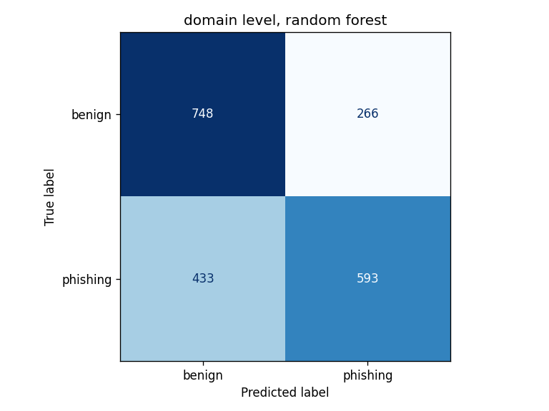
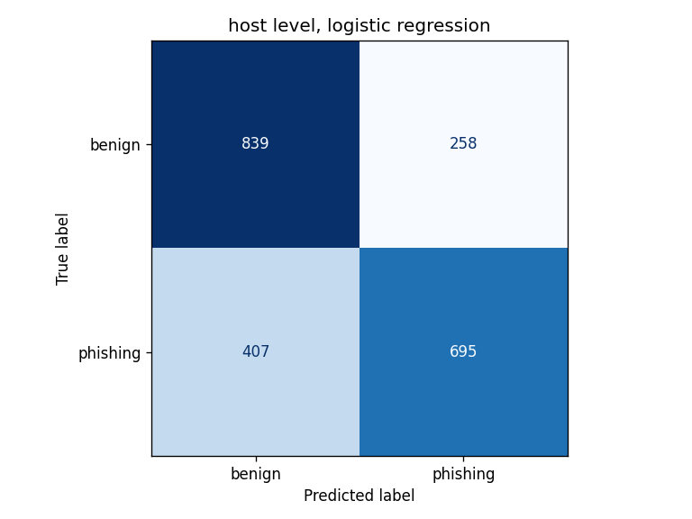
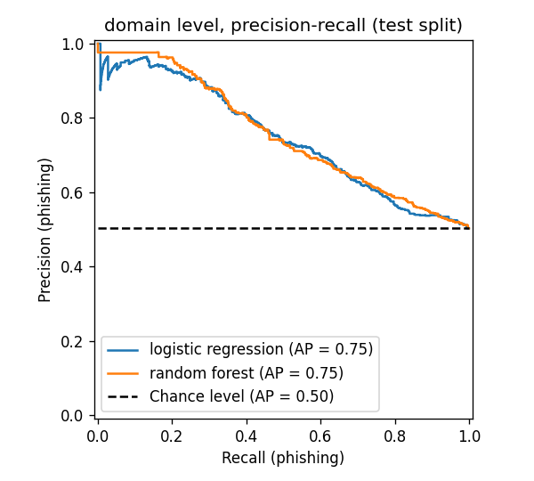
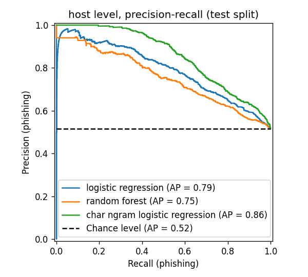

# Phishing Domain Detection with Machine Learning

A classifier that scores a URL as phishing or legitimate from its domain name alone, trained on PhishTank phishing reports and Tranco / Cisco Umbrella popular-domain lists.

This started as a team course project for CYB201/CIT251 at Pace University (fall 2025). I wrote the implementation. The first version reported 99% accuracy; that number was wrong, and the section [What I got wrong the first time](#what-i-got-wrong-the-first-time) explains why.

## How it works

1. **Build datasets** (`src/build_dataset.py`) from three raw sources:
   - PhishTank verified-online phishing URLs (label 1), snapshot from December 2025
   - Tranco top 1M domains (label 0), downloaded December 2025
   - Cisco Umbrella top 1M hostnames (label 0), downloaded October 2026

   Phishing URLs are deduplicated, and any whose registered domain is in Tranco is dropped. PhishTank lists abused legitimate sites like `docs.google.com`, `weebly.com`, and `bit.ly`; keeping them would teach the model that Google is phishing. Classes are then balanced by random sampling.

2. **Extract features** (`src/features.py`) from the domain name only. The path, query, and scheme are thrown away for every URL. Two experiments use two levels:

   | Experiment | Benign source | What gets scored | Why |
   |---|---|---|---|
   | **domain** (main) | Tranco | registered domain, e.g. `paypal-login-secure.com` | Tranco lists no subdomains, so subdomains are dropped for both classes |
   | **host** | Umbrella | full hostname, e.g. `paypal.com.account-check.xyz` | Umbrella has real subdomains (32.6% of benign hosts vs 40.5% of phishing) |

   Features (13 at domain level, 14 at host level):

   | Feature | Description |
   |---|---|
   | `length`, `num_hyphens`, `num_digits`, `digit_ratio` | Character counts of the name, without the public suffix |
   | `entropy` | Shannon entropy of the name (random-looking names score higher) |
   | `is_ip` | Host is a raw IPv4/IPv6 address |
   | `is_punycode` | Name contains `xn--` (internationalized, possible lookalike) |
   | `has_brand_word` | A brand like `paypal` appears, but the domain isn't the brand's own |
   | `has_lure_word` | Contains words like `login`, `verify`, `secure`, `account` |
   | `tld_com`, `tld_legacy`, `tld_country`, `tld_other` | TLD group: `.com`; `.net/.org/.edu/.gov/.mil/.int`; two-letter country codes; everything else (`.xyz`, `.top`, `.sbs`, ...) |
   | `subdomain_depth` | Host level only: number of labels before the registered domain |

3. **Split by campaign** (`src/preprocess.py`) with `GroupShuffleSplit` (80/20). The group is the registered domain without its public suffix, with every run of digits replaced by `#`, so no domain is in both train and test, and neither are kit domains that differ only by a number or the TLD (`pl-oferta48213.sbs` and `pl-oferta77120.cfd` both become `pl-oferta#`). IP hosts keep their address, so all of them become `#.#.#.#`.

4. **Train** (`src/train.py`) three models for each experiment: a Logistic Regression baseline and a Random Forest on the features above, and a Logistic Regression on character n-grams of the scored name itself (TF-IDF over 1- to 5-character substrings of `paypal-login-secure.com`, suffix included). The n-gram model checks what the hand-built features miss. Its settings were fixed before the first run and not tuned.

5. **Evaluate** (`src/evaluate.py`) on the held-out test split only. Reports precision, recall, F1, and false positive rate at the default 0.5 threshold, plus recall at a 1% and 5% false positive rate and average precision. Writes `results/metrics.json`, a confusion matrix per model, and a precision-recall curve per experiment. `src/repeat_splits.py` repeats the split with 10 seeds to show how much the numbers move by chance, and `src/ngram_audit.py` checks where the n-gram model's gain comes from. `src/time_split.py` splits phishing by date instead and runs the same checks. `src/grouping_audit.py` shows what the campaign grouping merges.

## Results

Mean and standard deviation over 10 campaign-grouped train/test splits (`results/repeated_splits.json`). Phishing is the positive class.

| Experiment | Model | Precision | Recall | F1 | False positive rate |
|---|---|---|---|---|---|
| domain (Tranco) | Logistic Regression | 69.1% ± 2.6 | 54.4% ± 1.9 | 60.9% ± 2.1 | 23.9% ± 1.1 |
| domain (Tranco) | Random Forest | 66.1% ± 2.7 | 56.3% ± 3.0 | 60.8% ± 2.7 | 28.4% ± 1.6 |
| domain (Tranco) | Char n-gram Logistic Regression | 70.8% ± 2.7 | 63.8% ± 2.3 | 67.1% ± 2.2 | 25.9% ± 2.1 |
| host (Umbrella) | Logistic Regression | 70.7% ± 2.0 | 62.9% ± 1.6 | 66.5% ± 1.3 | 25.5% ± 1.2 |
| host (Umbrella) | Random Forest | 67.8% ± 2.1 | 59.6% ± 2.1 | 63.4% ± 1.7 | 27.8% ± 1.4 |
| host (Umbrella) | Char n-gram Logistic Regression | 76.3% ± 2.2 | 67.4% ± 2.1 | 71.5% ± 1.7 | 20.5% ± 1.6 |

Operating points, over the same 10 splits:

| Experiment | Model | Recall at 1% FPR | Recall at 5% FPR | Average precision |
|---|---|---|---|---|
| domain (Tranco) | Logistic Regression | 13.7% ± 4.3 | 30.3% ± 3.7 | 72.6% ± 2.8 |
| domain (Tranco) | Random Forest | 12.7% ± 7.9 | 27.6% ± 4.6 | 71.5% ± 3.6 |
| domain (Tranco) | Char n-gram Logistic Regression | 27.7% ± 4.8 | 38.8% ± 4.1 | 79.6% ± 2.6 |
| host (Umbrella) | Logistic Regression | 10.2% ± 4.3 | 28.6% ± 3.8 | 74.7% ± 2.4 |
| host (Umbrella) | Random Forest | 11.4% ± 6.6 | 28.9% ± 4.0 | 73.3% ± 2.8 |
| host (Umbrella) | Char n-gram Logistic Regression | 32.7% ± 3.2 | 45.4% ± 3.3 | 83.8% ± 1.6 |

Recall at a fixed false positive rate is the best recall at any threshold whose false positive rate on the test split is at or below the target. The threshold is read off the test split's ROC curve, so this describes how well the model ranks domains; a threshold picked on one split won't land at exactly 1% on new data. With about 1,000 benign test rows, 1% allows about 10 false positives, so that column moves a lot between splits. Ties make it worse: a Random Forest score of 1.0 means all 100 trees agree, and many rows share the top score. In two of the ten splits at each level, 11 to 15 benign and 79 to 93 phishing domains tie at the forest's top score, more benign rows than 1% allows, so no threshold can take any of them and those splits' recall at 1% is 0. Those splits account for most of the forest's ± 7.9 on domains and ± 6.6 on hosts; the other eight range from 7.8% to 23.6% on domains and from 9.4% to 17.9% on hosts. Each split's value and tie count are in `results/repeated_splits.json` (`per_split`).

Precision and average precision depend on the class balance. The test sets are about 50/50; in real traffic phishing is a small fraction of domains, so precision at any threshold would be much lower. Recall at a fixed false positive rate doesn't depend on the balance.

The saved split that `predict.py`'s model and the confusion matrices and precision-recall curves below come from (`results/metrics.json`):

| Experiment | Model | Precision | Recall | F1 | False positive rate |
|---|---|---|---|---|---|
| domain (Tranco) | Logistic Regression | 70.5% | 57.0% | 63.1% | 23.0% |
| domain (Tranco) | Random Forest | 64.7% | 56.6% | 60.4% | 29.7% |
| domain (Tranco) | Char n-gram Logistic Regression | 69.0% | 65.3% | 67.1% | 28.2% |
| host (Umbrella) | Logistic Regression | 73.3% | 65.9% | 69.4% | 25.6% |
| host (Umbrella) | Random Forest | 70.8% | 59.7% | 64.8% | 26.2% |
| host (Umbrella) | Char n-gram Logistic Regression | 77.8% | 67.8% | 72.4% | 20.6% |

A single split can land a couple of points away from the mean, so differences smaller than that between models or experiments don't mean much. All 32 IP hosts are one campaign, so a split puts them all on one side, and this one puts them all in test (`ip_rows` in `results/metrics.json`). The saved models have never seen an IP host: `is_ip` has no weight in their forests, and the sanity check below gives `192.168.4.20` 0.50.

Dataset sizes after cleaning:

| | Phishing | Benign | Train | Test |
|---|---|---|---|---|
| domain | 5,015 | 5,015 | 7,988 | 2,042 |
| host | 5,015 | 5,015 | 7,930 | 2,100 |

The Random Forest doesn't beat the linear baseline, which suggests the signal in these features is mostly simple (longer, more random-looking names with more hyphens and digits, on cheap TLDs). Entropy and length carry about 60% of the forest's feature importance in both experiments. At the default 0.5 threshold the false positive rate is above 20%, far too high for blocking anything. Ranked by score, the top slice of each test split that stays within a 1% false positive rate holds 10 to 14% of the phishing domains on average, but a threshold set to hit 1% on one split won't hit it exactly on new data. That's a narrow high-confidence slice, useful as one signal for triage, not as a filter. A third to a half of that slice is one brand: 31 to 50% of these models' catches at 1% FPR are Allegro-themed, while Allegro is 6 to 8% of the phishing test rows. On test names that don't repeat kit wording seen in training, these models' recall at 1% FPR is only 2 to 4% (below, and `results/ngram_audit.json`).

The character n-gram model ranks better than all four hand-feature models. Recall at 1% FPR goes from 12.7–13.7% to 27.7% on domains and from 10.2–11.4% to 32.7% on hosts, and average precision rises by 7 to 11 points. At 0.5 its false positive rate is still 20 to 26%. `src/ngram_audit.py` reruns the 10 splits to see where the gain comes from, and much of it isn't new information about how phishing names look:

- **On domains, much of it is the TLD.** The hand features sort TLDs into four groups, so `.cfd`, `.icu`, and `.sbs` look the same to them. Adding the full suffix to the hand features takes recall at 1% FPR from 13.7% to 19.4% on domains, about 40% of the way to the n-gram model, and from 10.2% to 16.3% on hosts. Many of the heaviest n-grams are TLDs (at domain level, `.cfd` and `.icu` toward phishing, `.ru`, `.jp`, and `.gov` toward benign; `results/metrics.json`). TLD abuse moves fast, so that part is the most likely to decay.
- **Not just Allegro.** Without the Allegro-themed rows, the n-gram model still gets 22.0% at 1% FPR on domains against 7.4 to 8.4% for the hand-feature models, and 28.2% against 5.1 to 8.2% on hosts.
- **Much of the rest is kit wording that repeats across the split.** Kits reuse words (`pl-oferta`, `coursier`, `-pickup-`) across names the campaign grouping keeps apart. 27% of the domain and 35% of the host test phishing names share an 8-character substring with a training phishing name (digit runs as `#`, suffix stripped). Without those rows, recall at 1% FPR drops for every model: the hand-feature models get 1.7 to 3.9%, and the n-gram model 12.6% on domains and 11.6% on hosts. On those domains it does little better than the suffix alone (11.9%) or the hand features plus the suffix (10.1%). On hosts it keeps a lead (11.6% against 8.6% and 7.1%). The filter also drops names that only share ordinary words, so these numbers likely understate how the models do on new names. It also can't flag a name shorter than 8 characters once digits are collapsed, so a few short kit copies stay in. Kits do get reused, so repeated wording is a real signal, but a random split can't say how long it keeps working. The time-based split below is a first look, over two weeks.
- **A known artifact shows up.** On hosts, `cdn` and `api`, from Umbrella's infrastructure hostnames, weigh toward benign. `.1`, from IP hosts, isn't among the heaviest n-grams this time, since the saved split has no IP host in training.

<p>
  
  
</p>

<p>
  
  
</p>

`src/sanity_check.py` scores a fixed list of real and made-up URLs. Real legitimate domains it scores high: `login.microsoftonline.com` (0.79 on the domain model, pushed up because "microsoft" appears in a domain that isn't `microsoft.com`) and `paypal.com` (0.56). The made-up phishing URLs score high except the IP host (0.50, see above) and the punycode lookalike (0.68), but they were written to look like phishing, so they say little about recall. The test-set numbers above are the honest ones.

### Time-based split

`src/time_split.py` splits phishing by date instead of at random (`results/time_split.json`). A phishing domain's date is its earliest submission in `verified_online.csv`; earlier reports on the same domain that had already gone offline aren't in the file. A campaign (grouped as above) starts at its earliest domain. Campaigns that started on or after the cut go to test, the rest to training. The cut is the 80th percentile of campaign start times, chosen before any model was trained on this split, and falls on 17 November 2025. That puts 4,043 phishing domains in training and 972 in test, all first submitted between 17 November and 1 December 2025. 16 campaign groups started before the cut and went on after it: eight numbered kits such as `pl-oferta#`, `oferta-#`, and `id#`, the group that holds every IP host, the names made only of digits, and six other names (`gouv`, `smbc`, `framer`, `lnk`, `#google`, `#research`). They stay in training, with their 150 later domains. Kits that vary letters are separate groups, so, as in the random split, some can still sit on both sides. The phishing split comes out the same at both levels. Tranco and Umbrella have no dates, so benign rows are split at random as before, over 10 seeds. The phishing side is the same in all 10 runs, so the ± only shows how much the benign sample moves the numbers.

Mean over the 10 runs, with the random split's mean from the tables above in parentheses:

| Experiment | Model | Recall at 1% FPR | Recall at 5% FPR | Average precision |
|---|---|---|---|---|
| domain (Tranco) | Logistic Regression | 13.4% ± 3.4 (13.7%) | 31.3% ± 1.1 (30.3%) | 73.8% ± 0.7 (72.6%) |
| domain (Tranco) | Random Forest | 8.2% ± 4.0 (12.7%) | 26.0% ± 1.1 (27.6%) | 70.9% ± 0.7 (71.5%) |
| domain (Tranco) | Char n-gram Logistic Regression | 32.9% ± 1.9 (27.7%) | 44.6% ± 1.9 (38.8%) | 81.7% ± 0.8 (79.6%) |
| host (Umbrella) | Logistic Regression | 10.2% ± 2.1 (10.2%) | 30.4% ± 2.4 (28.6%) | 76.6% ± 0.9 (74.7%) |
| host (Umbrella) | Random Forest | 8.8% ± 3.4 (11.4%) | 25.7% ± 3.4 (28.9%) | 71.3% ± 1.2 (73.3%) |
| host (Umbrella) | Char n-gram Logistic Regression | 37.0% ± 2.1 (32.7%) | 51.9% ± 1.9 (45.4%) | 86.3% ± 0.5 (83.8%) |

At 0.5 the false positive rate is 23 to 28%, against 20 to 28% on the random split.

The n-gram model scores higher than on the random split, and the hand-feature models score the same or lower, by up to 4.5 points. Besides its date, the test phishing differs in two ways, and the audit models from `src/ngram_audit.py` show which models each one helps:

- **A little more Allegro.** Allegro is 9.0% of the test phishing here, against 6 to 8% in the random test sets, and the three models above catch 35 to 100% of it at 1% FPR. Before TLD variants were grouped it was 13.2%: copies of kits that had started before the cut, under a new TLD, counted as new campaigns and went to test. Without the Allegro rows, recall at 1% FPR stays level or drops for the hand-feature models (on domains, Logistic Regression goes from 7.4% to 7.3% and Random Forest from 8.4% to 5.5%; on hosts, 5.1% to 3.5% and 8.2% to 5.4%) and rises for the n-gram model (22.0% to 27.3% on domains, 28.2% to 30.7% on hosts).
- **Different TLDs.** `.cfd`, `.icu`, `.sbs`, and `.lat` together are 22.7% of the test phishing, against 5.5% of the training phishing and 0.1% of Tranco. Shares of the registrable suffix at domain level:

  | Suffix | Training phishing | Test phishing | Benign (Tranco) |
  |---|---|---|---|
  | `.com` | 49.9% | 28.2% | 41.7% |
  | `.cn` | 4.2% | 18.4% | 5.9% |
  | `.cfd` | 2.2% | 9.6% | 0.0% |
  | `.icu` | 1.6% | 5.3% | 0.1% |
  | `.lat` | 0.1% | 4.2% | 0.0% |
  | `.sbs` | 1.5% | 3.6% | 0.0% |

- **The gain goes with the suffix.** Without the Allegro rows, the models that see the full suffix do better than on the random split and the ones that don't, don't. The suffix alone goes from 8.5% to 18.2% on domains and from 7.7% to 19.5% on hosts, and the hand features plus the suffix from 13.3% to 18.9% and from 11.3% to 13.6%. The n-gram model on the name with the suffix stripped goes from 17.9% to 16.2% and from 24.3% to 22.0%.
- **Names that don't repeat kit wording.** 19% of the domain and 31% of the host test phishing names share an 8-character substring with a training phishing name, against 27% and 35% on the random split. On the rest, the suffix alone gets 26.6% on domains and 21.9% on hosts, against 23.6% and 18.6% for the n-gram model, 21.3% and 12.2% for the hand features plus the suffix, 8.1% and 8.3% for the name-only n-gram model, and 1.8 to 6.8% for the hand-feature models.

So on this split, once Allegro is set aside, the n-gram model's gain lines up with the suffix and not with the name: more of the newest phishing in this snapshot is on a few cheap TLDs that Tranco barely has. That's a pattern across the audit models, not a measured cause. TLD abuse moves fast, so it's also the part least likely to last. Two things make this a weak test of time. The test window is two weeks. And `verified_online.csv` only lists phishing that was still online in December 2025, so the training side is older phishing that stayed up (29% of it first submitted before 2025), and the gap between training and test is partly long-lived against fresh phishing, not only older against newer.

## What I got wrong the first time

The first version of this project ([`results/original_run.txt`](results/original_run.txt)) reported these held-out numbers for a Random Forest on 95,972 URLs:

| Accuracy | Precision | Recall | False positive rate |
|---|---|---|---|
| 99.46% | 99.80% | 99.12% | 0.20% |

They meant nothing. The benign URLs were built by putting `https://` in front of each Tranco domain, so every benign example was a bare homepage. Phishing URLs from PhishTank are full links:

| | Starts with `https` | Has `/` after the host | Has a real path | Has `?` query |
|---|---|---|---|---|
| Benign | 100% | 0% | 0% | 0% |
| Phishing | 95.3% | 97.0% | 67.0% | 20.9% |

So the model learned "anything after the domain = phishing." `num_slashes` alone carried 60% of the feature importance. Real legitimate URLs all scored as phishing, and an obvious phishing domain scored as safe:

```text
P(phish)=1.00  https://www.amazon.com/gp/your-account/order-history?ref_=ya_d_c_yo
P(phish)=1.00  https://en.wikipedia.org/wiki/Phishing
P(phish)=1.00  https://www.chase.com/personal/checking
P(phish)=0.99  http://paypal.com
P(phish)=0.11  https://paypal-login-secure.com
```

Three more problems:

- **Random row split.** PhishTank often has many URLs on one domain, so the same domain landed in both train and test. Only 5,875 of 47,994 phishing URLs have a distinct registered domain.
- **Evaluating on training data.** `evaluate.py` scored the model on the full dataset, training rows included.
- **The same leak one level down.** Switching to hostname features wasn't enough on its own: Tranco has no subdomains (0%), while 84% of PhishTank hostnames have one, so subdomain count would have given the label away the same way. That's why the domain experiment scores the registered domain only, and why the host experiment uses Umbrella, which does have subdomains.

Reviews of the fixed version found three smaller issues, now fixed:

- **Kit domains on both sides of the split.** Kits register domains that differ only by a number. Grouping by registered domain alone let 74 of these into the domain test set while their siblings were in training. The Random Forest caught 96% of them, against 52.5% of the other phishing test rows. The split is now grouped by the digit-collapsed pattern. Averaged over 10 splits, the change moved recall by less than one standard deviation, so the effect on the headline numbers was small, but the old split was still measuring memorization for those rows.
- **Unequal deduplication in the host experiment.** Benign hosts were capped at one per registered domain and phishing hosts weren't, so a few site builders contributed dozens of phishing rows each. Both sides are now capped the same way.
- **Kit domains under different TLDs on both sides of the split.** The digit-collapsed group kept the suffix, so `pl-oferta#.cfd`, `pl-oferta#.icu`, and `pl-oferta#.sbs` were separate campaigns. Over the 10 random splits, 7.4% of the domain and 7.1% of the host test phishing had a training phishing domain with the same name under another TLD (`results/grouping.json`). The group now drops the suffix. That merges 228 groups into 91 at domain level and 250 into 101 at host level. The largest group grows from 33 to 126 domains (`pl-oferta#`), and the biggest merge of unrelated names is the domains made only of digits (`#`, 54 at domain level and 63 at host level). Groups with both phishing and benign rows go from 2 to 10 on domains and from 2 to 6 on hosts, mostly the all-digit group, short names (`bio.now` and `bio.link`), and lookalikes next to the real site (`sfr.info` and `sfr.fr`); `results/grouping.json` lists them. Means over the 10 splits, before (commit `eda0870`, `results/repeated_splits.json`) and after:

  | Experiment | Model | F1 | Recall at 1% FPR | Average precision |
  |---|---|---|---|---|
  | domain (Tranco) | Logistic Regression | 61.4% → 60.9% | 14.4% → 13.7% | 73.9% → 72.6% |
  | domain (Tranco) | Random Forest | 61.8% → 60.8% | 15.4% → 12.7% | 73.2% → 71.5% |
  | domain (Tranco) | Char n-gram Logistic Regression | 67.7% → 67.1% | 28.2% → 27.7% | 80.8% → 79.6% |
  | host (Umbrella) | Logistic Regression | 66.9% → 66.5% | 11.1% → 10.2% | 74.5% → 74.7% |
  | host (Umbrella) | Random Forest | 63.7% → 63.4% | 13.6% → 11.4% | 74.4% → 73.3% |
  | host (Umbrella) | Char n-gram Logistic Regression | 71.7% → 71.5% | 33.6% → 32.7% | 84.0% → 83.8% |

  The seeds are the same but the groups aren't, so each split's test set changed too. Every model's recall at 1% FPR dropped, the most for the forests, but by less than one standard deviation. At 0.5 the false positive rate went up 1.5 to 1.9 points for the domain hand-feature models and the host forest, more than one standard deviation. The spread of recall at 1% FPR grew on domains (the forest's from ± 2.9 to ± 7.9). In the time split, Allegro fell from 13.2% to 9.0% of the test phishing (below).

The lesson: when two classes come from different sources, check every column for differences in how the data was collected before trusting any score. A near-perfect result on a hard problem is a reason to look for leakage, not to celebrate.

## Limitations

- **Domain-only features can't see path tricks.** A phishing page on a compromised legitimate site, or on a free host like `weebly.com` or `web.app`, is invisible to this model, and those were dropped from training (85% of PhishTank rows had a registered domain in Tranco).
- **PhishTank is skewed.** 8.5% of phishing domains (426 of 5,015, by PhishTank's `target` column) imitate one brand, Allegro, mostly from a few kits. The campaign grouping only merges domains that differ by digits or the TLD; kits that vary letters (`298278sdhsprywanie.cfd`) can still sit on both sides of the split.
- **Benign means popular.** Tranco and Umbrella are popularity lists. The model partly learns "popular vs obscure," and Umbrella also includes CDN and API hostnames that don't look like sites people visit.
- **`is_ip` only appears in phishing.** Neither benign list has IP hosts, so a model trained with IP hosts treats any IP as phishing. They're all one campaign, so each split puts all of them in training or all in test, and the saved split behind `predict.py` puts them in test: its models have never seen an IP host.
- **The data snapshots are 10 months apart.** PhishTank is from December 2025 and Umbrella from October 2026. Naming and TLD trends that shifted in between can look like a phishing signal, and Umbrella's overlap with these phishing domains is understated because most of them stopped getting DNS traffic long before the Umbrella snapshot.
- **Only phishing that stayed online.** `verified_online.csv` lists phishing still online in December 2025. Older rows are the ones that stayed up, which is not a random sample of the phishing from their time.
- **Lexical models decay.** Attackers change naming patterns and TLDs, and a model trained on one snapshot gets worse over time.
- **Small dataset.** About 10,000 rows per experiment after deduplication.

## How to run

Tested with Python 3.9.6.

```bash
git clone https://github.com/NclRsi46/phishing-detection-ml.git
cd phishing-detection-ml
python3 -m venv venv
source venv/bin/activate
pip install -r requirements.txt
```

Create `data/raw/` (`mkdir -p data/raw`) and put the raw data in it (not committed):

- `verified_online.csv`: PhishTank's verified online phishing CSV (phishtank.org)
- `tranco.csv`: Tranco top 1M list, `rank,domain` with no header (tranco-list.eu)
- `umbrella.csv` (optional, for the host experiment): Cisco Umbrella top 1M, `rank,hostname` with no header, from `https://s3-us-west-1.amazonaws.com/umbrella-static/top-1m.csv.zip`

Run the pipeline from the project root:

```bash
python src/build_dataset.py
python src/preprocess.py
python src/train.py
python src/evaluate.py
python src/repeat_splits.py
python src/ngram_audit.py
python src/time_split.py
python src/grouping_audit.py
python src/sanity_check.py
python tests/test_features.py
python tests/test_split.py
python tests/test_metrics.py
python tests/test_train.py
python tests/test_predict.py
python tests/test_audit.py
python tests/test_time_split.py
python tests/test_grouping.py
```

Score a single URL with the domain-level Random Forest:

```bash
python src/predict.py "https://paypal-login-secure.com/x?y=1"
```

```text
URL:          https://paypal-login-secure.com/x?y=1
Scored:       paypal-login-secure.com (domain level, path and query ignored)
P(phishing):  0.970
Prediction:   Phishing
```

Use `--model models/host_random_forest.pkl` (or any other model in `models/`) to score with a different one.

## Project structure

```text
phishing-detection-ml/
├── data/
│   ├── raw/            source CSVs (not committed)
│   └── processed/      datasets and train/test splits (not committed)
├── models/             trained models (not committed)
├── results/
│   ├── metrics.json
│   ├── repeated_splits.json
│   ├── ngram_audit.json
│   ├── time_split.json
│   ├── grouping.json
│   ├── confusion_*.png
│   ├── pr_curve_*.png
│   └── original_run.txt
├── src/
│   ├── features.py      feature extraction shared by preprocess and predict
│   ├── build_dataset.py
│   ├── preprocess.py
│   ├── train.py
│   ├── evaluate.py
│   ├── predict.py
│   ├── repeat_splits.py
│   ├── ngram_audit.py
│   ├── time_split.py
│   ├── grouping_audit.py
│   └── sanity_check.py
├── tests/
│   ├── test_features.py
│   ├── test_split.py
│   ├── test_metrics.py
│   ├── test_train.py
│   ├── test_predict.py
│   ├── test_audit.py
│   ├── test_time_split.py
│   └── test_grouping.py
└── requirements.txt
```
